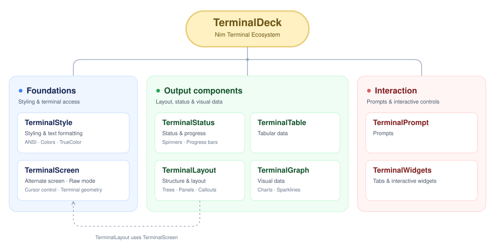

# TerminalDeck

TerminalDeck is a collection of pure-Nim libraries for terminal applications:
styled text, tables, charts, progress displays, structured output, prompts,
and interactive widgets. Install the `terminal_deck` meta package to get all
eight libraries through Nimble, then import the packages your application uses.



## Requirements and platform support

- Nim 2.2.0 or newer and Nimble.
- A terminal with ANSI/VT support for colors, cursor control, and interactive
  components; Unicode support for box drawing and chart glyphs.

The libraries target Linux, macOS, and Windows. Platform testing and terminal
requirements vary by package; see each library's README for details.

## Contents

- [Packages and documentation](#packages-and-documentation)
- [Installation](#installation)
- [Quick start](#quick-start)
- [Development](#development)
- [License](#license)

## Packages and documentation

Each library can also be installed independently. Package names below are the
Nimble names and main import modules. Documentation links lead to each library's
GitHub Pages site.

| Library | Package / import | Description | Documentation |
| --- | --- | --- | --- |
| **Foundations** | | | |
| [TerminalStyle](https://github.com/titanomachy/terminal-style) | `terminal_style` | ANSI colors, RGB palettes, text attributes, and Unicode-aware measuring, padding, and wrapping. | [GitHub Pages](https://titanomachy.github.io/terminal-style/) |
| [TerminalScreen](https://github.com/titanomachy/terminal-screen) | `terminal_screen` | Guarded terminal sessions, raw mode, normalized keyboard events, cursor control, and terminal geometry. | [GitHub Pages](https://titanomachy.github.io/terminal-screen/) |
| **Output components** | | | |
| [TerminalStatus](https://github.com/titanomachy/terminal-status) | `terminal_status` | Spinners, single and multiple progress bars, task step trackers, and live status output. | [GitHub Pages](https://titanomachy.github.io/terminal-status/) |
| [TerminalTable](https://github.com/titanomachy/terminal-table) | `terminal_table` | Styled and responsive tables, live data displays, and typed, CSV, and JSON data adapters. | [GitHub Pages](https://titanomachy.github.io/terminal-table/) |
| [TerminalLayout](https://github.com/titanomachy/terminal-layout) | `terminal_layout` | Trees, panels, cards, nested lists, callouts, and banners that render to composable strings. | [GitHub Pages](https://titanomachy.github.io/terminal-layout/) |
| [TerminalGraph](https://github.com/titanomachy/terminal-graph) | `terminal_graph` | Line, bar, candle, and scatter charts; sparklines, surfaces, contours, and live dashboards. | [GitHub Pages](https://titanomachy.github.io/terminal-graph/) |
| **Interaction** | | | |
| [TerminalPrompt](https://github.com/titanomachy/terminal-prompt) | `terminal_prompt` | Text, password, confirmation, single-select, and multi-select prompts with cancellation and EOF handling. | [GitHub Pages](https://titanomachy.github.io/terminal-prompt/) |
| [TerminalWidgets](https://github.com/titanomachy/terminal-widgets) | `terminal_widgets` | Stateful checkboxes, switches, tabs, menus, text fields, and scrollable lists with keyboard focus and an optional runtime. | [GitHub Pages](https://titanomachy.github.io/terminal-widgets/) |

Use TerminalPrompt to ask a question and return an answer. Use TerminalWidgets
for controls that remain on screen as part of an application. TerminalStyle
provides shared text styling; TerminalScreen provides terminal access and input.

## Installation

The TerminalDeck meta package uses minimum version requirements, allowing Nimble
to install the latest tagged release of each included library that satisfies all
dependency constraints. A project lockfile can keep older versions pinned.

Install directly from the repository:

```sh
nimble install https://github.com/titanomachy/terminal-deck
```

Nimble installs the eight dependencies automatically. Once `terminal_deck` is
published in the official Nimble package index, it can also be installed by name:

```sh
nimble install terminal_deck
```

To install just one library, use its package name instead:

```sh
nimble install terminal_graph
```

## Quick start

After installing TerminalDeck, save this as `hello.nim`:

```nim
import terminal_graph

echo plot(
  [3, 4, 9, 6, 2, 4, 5, 8],
  graphWidth(40),
  graphHeight(8),
  graphCaption("Request latency")
)
```

Run it with:

```sh
nim r hello.nim
```

TerminalDeck manages dependencies and version requirements. It has no
`terminal_deck` module or executable; import each library you need. Follow the
repository links above for runnable examples and the documentation links for
API references.

## Development

From a checkout, validate the manifest and test installation in an isolated
Nimble directory:

```sh
terminaldeck_test_dir="$(mktemp -d)"
nimble --nimbleDir:"$terminaldeck_test_dir" --useSystemNim check
nimble --nimbleDir:"$terminaldeck_test_dir" --useSystemNim install -y
nimble --nimbleDir:"$terminaldeck_test_dir" --useSystemNim deps
nimble --nimbleDir:"$terminaldeck_test_dir" --useSystemNim list --installed
```

The meta package contains only a dependency manifest, so there is no binary to
build. Tests and documentation generation live in the individual library
repositories.

Dependencies use minimum versions, allowing Nimble to select newer releases
that satisfy their requirements. When changing the collection, update
[`terminal_deck.nimble`](terminal_deck.nimble) and this package table, bump the
meta package version, and tag the release. Removing a dependency from the
manifest does not uninstall it from an existing Nimble environment.

## License

TerminalDeck is released under the [MIT License](LICENSE). Each library includes
its own license and any applicable attribution notices in its repository.
